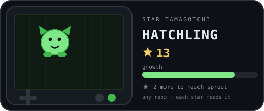

# 👋 Hey, I'm Jason
<div align="center">

  

</div>

---

## 🥚 Star Tamagotchi

A pet lives in this README, and the only food it accepts is a ⭐ — on **any** repo I wrote, not just this one. Star any of them and it grows.

<p align="center">
  
</p>

| Total stars | Stage |
| :---: | :--- |
| 0 | 🥚 egg — unhatched |
| 5 | 🐣 hatchling — just out of the shell |
| 15 | 🐸 sprout — growing fast |
| 40 | 🐲 chonk — well fed |
| 100 | 👑 legend — crowned |

Stars are counted across every repo I wrote (forks of other people's work don't count, and except scriptura which will be handed over). A star anywhere wakes it within seconds — the other repos shout over when they get one, and a five-minute poll catches anything missed, so no one has to herd it.

---

## 🧑‍💻 About Me

I'm a **hobby developer** who codes because I genuinely enjoy it. Day job is one thing — nights and weekends are for building, refining, and solving interesting problems.

- 🌱 Currently creating tools that is personal to myself
- ⚡ Fun fact: I still read the docs first… most of the time

---
## 🚀 Projects

**Status key:** 🟢 daily driver · 🔵 frequently used · 🟡 sometimes used · 🟠 rarely used · 🔴 not ready · 🩶 not a tool

| Project | Status | Replaces / aims to replace |
| :--- | :---: | :--- |
| [**weather-ext**](https://github.com/jason1015-coder/weather-ext) | 🔵 | Weather apps, weather.com tabs, ad-heavy weather extensions |
| [**audio-pitch-converter**](https://github.com/jason1015-coder/audio-pitch-converter) | 🔵 | Audacity pitch-shifting, 432Hz converter sites, paid retune plugins |
| [**quick-note-ext**](https://github.com/jason1015-coder/quick-note-ext) | 🟡 | Google Keep / Notion quick-capture, sticky-note extensions |
| [**manager-ext**](https://github.com/jason1015-coder/manager-ext) | 🟡 | Digging through `chrome://extensions`, "extension manager" store extensions |
| [**scriptura**](https://github.com/jason1015-coder/scriptura) | 🔴 | VS Code / Cursor / JetBrains IDEs |
| [**Project-metropolis** ](https://github.com/jason1015-coder/project-metropolis) | 🩶 | other boring display pages |
| [the tamagotchi at **my profile** ](https://github.com/jason1015-coder/jason1015-code) | 🩶 | other boring display pages |


> 🍴 Org and forked work not listed above because it's not built from scratch here.

## 📫 Let's Connect

<div align="center">

[](https://github.com/jason1015-coder)

</div>


<div align="center">

  

</div>

---

<details>
  <summary>📖 Random Dev Joke (Click me!)</summary>
  
```
A programmer’s wife tells him:
“Go to the store and buy a loaf of bread. If they have eggs, buy a dozen.”
He comes home with 12 loaves of bread.
```
